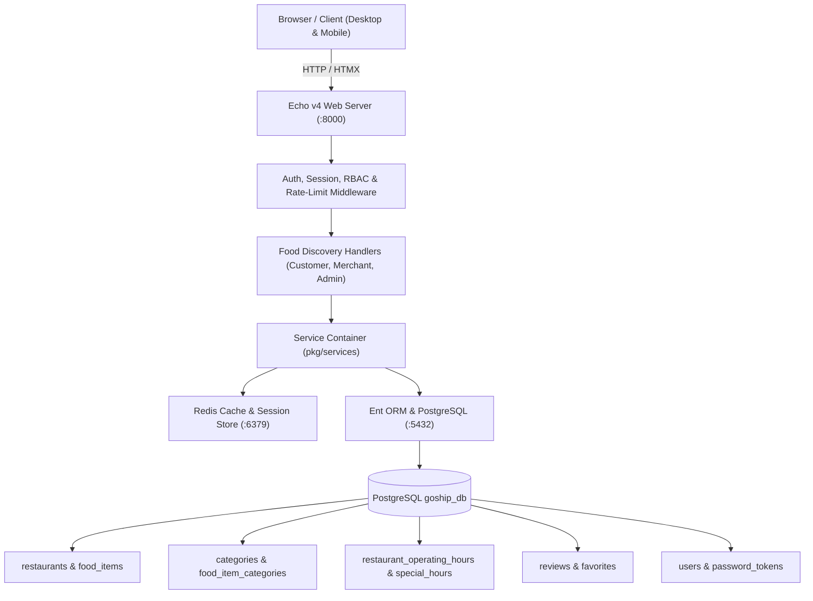

# Under100 (Bite100) — Master Engineering Handover Document

* **Project:** Under100 (Bite100) — Bengaluru Hyperlocal Food Discovery (Dishes $\le$ ₹100)
* **Date:** October 19, 2026
* **Repository Path:** `C:\Users\astha\Desktop\food-discovery`
* **Active Git Branch:** `feat/food-discovery`
* **Handover Status:** **STABLE & VERIFIED (Ready for Handover & Demonstration)**
* **Active Web Server:** `http://127.0.0.1:8000/` (Daemon process: `under100_server.exe`)

---

## 1. Project Overview & Architectural Scope

Under100 is a dedicated food discovery platform created for Bengaluru's budget dining scene. Unlike conventional aggregators that promote high-ticket restaurants with heavy delivery surcharges, Under100 enforces a platform-wide philosophy:
1. **Strict Budget Ceiling:** Every discoverable dish is priced at or below ₹100.
2. **Hyperlocal Precision:** Real-time distance and travel time calculation based on Bengaluru culinary clusters.
3. **Availability Accuracy:** Timezone-aware (`Asia/Kolkata`) 7-day schedule evaluation with overnight shift support and temporary closure overrides.
4. **Zero-Bloat Stack:** Built with Go 1.24, Echo v4, Ent ORM, PostgreSQL 15, Redis 5, and server-side rendered HTML/HTMX. No extraneous single-page framework overhead.

---

## 2. Implemented & Verified Functionality

### A. Customer-Facing Workflows
- **Discovery Homepage (`/`):**
  - Displays hero search bar, category chips, 4 curated horizontal tracks ("Under ₹100", "South Indian Classics", "Quick Bites Under ₹50", "Bengaluru Heritage Picks").
  - Automated GPS browser geolocation with Haversine nearest-first sorting across 11 Bengaluru hubs.
  - Interactive ADD button transforming into `- 1 +` counter steppers.
  - Slide-out cart drawer with live subtotal calculation, free delivery guarantee, and order confirmation modal.
  - "Order for Someone Else" dual-tab delivery address modal with recipient contact management.
- **Search & Filter Engine (`/nearby`):**
  - Text search across dish names, restaurant titles, and neighborhood street addresses.
  - Cuisines & Meal Types: 12 canonical categories (`south-indian`, `north-indian`, `chinese`, `street-food`, `snacks`, `breakfast`, `lunch`, `desserts`, `beverages`, etc.).
  - Dietary toggle: Pure Vegetarian (`diet=veg`) and Non-Vegetarian.
  - Real-time availability filter: **"Open Now"** (`open_now=true`) displaying green badges for open outlets, red for temporarily closed, and gray for unconfigured schedules.
  - Safe pagination preserving active search, category, budget, and open_now parameters.
- **Restaurant Details Modal (`/restaurant/:id`):**
  - Full outlet profile with address, contact number, and live availability badge.
  - Collapsible 7-day operating schedule with **TODAY** highlighted.
  - Dish listing grouped by categories with price tags strictly $\le$ ₹100.
  - Customer review list, aggregate rating average (1.0–5.0), and 5-star rating submission form.
- **Favorites (`/favorites`):**
  - Authenticated customer bookmarking with HTMX toggle on cards and modal.
  - Enforced `UNIQUE(user_id, restaurant_id)` database constraint preventing duplicate favorites.

### B. Merchant Portal Workflows (`/merchant`)
- **Self-Service Onboarding:**
  - Registration via `/register?role=merchant`. Unassigned merchants see an empty state prompting them to register their restaurant.
  - Restaurant submission via `/merchant/restaurant/submit` with server-side validation of phone, coordinates, and operating hours. Submissions enter `pending` state awaiting admin review.
- **Menu Management (`/merchant/menu`):**
  - Add and edit dishes with price validation: prices $\le$ ₹100 are saved; prices $\le$ 0 or > ₹100 are rejected with HTTP 400.
  - Toggle live dish availability.
- **Operating Hours Management (`/merchant/hours`):**
  - 7-day schedule editor: Monday through Sunday open/close time pickers with overnight support.
  - Atomic replacement of operating hours in PostgreSQL (`restaurant_operating_hours`).
  - Temporary closure scheduler (`/merchant/hours/temporary-closure`) with custom reason and ISO-8601 date ranges.
- **Ownership & IDOR Protection:**
  - Strict middleware and repository verification ensures merchants can only view and mutate their own assigned restaurant. Any attempt to modify another restaurant's menu or schedule returns HTTP 403 Forbidden.

### C. Admin Dashboard Workflows (`/admin`)
- **Moderation Queue:**
  - Restaurant status management: inspect pending self-service submissions, approve to live discovery, or reject with feedback.
  - Pending/rejected restaurants are strictly concealed from public discovery, search, and customer access (HTTP 404).
- **Category Management (`/admin/categories`):**
  - Full CRUD for food categories and cuisines with unique slug validation (`slugify`).
  - Active/Inactive toggle enabling non-destructive archival without cascading deletion of food items.
- **Review Moderation (`/admin/reviews`):**
  - Reported reviews triage with reason badges.
  - Hide and restore toggles dynamically recalculating public restaurant aggregate rating averages.

---

## 3. System Architecture & Component Flow



### Key Source Directories & Files:
| Path | Purpose |
| :--- | :--- |
| `cmd/web/main.go` | HTTP server initialization, graceful shutdown, timeout middleware |
| `pkg/services/container.go` | Dependency injection container (DB, Cache, Config, Mailer, Auth) |
| `pkg/routing/fooddiscovery/` | HTTP controllers for customer discovery, merchant portal, and admin |
| `pkg/repos/fooddiscovery/` | Availability engine (`hours_repo.go`), category repo (`category_repo.go`), discovery queries (`food_discovery.go`) |
| `ent/schema/` | Ent data model definitions (`restaurant.go`, `fooditem.go`, `user.go`, etc.) |
| `static/` | Bundled CSS, icons, and 19 SHA256-verified static food photos |
| `templates/` | Go HTML templates with HTMX integration |

---

## 4. Authentication & Authorization Design

The platform uses server-side session cookies authenticated via Redis with role-based access control (RBAC):

1. **Guest (Unauthenticated):**
   - Can access storefront (`/`), search/filtering (`/nearby`), restaurant details (`/restaurant/:id`).
   - Blocked from favorites, reviews, merchant portal, and admin dashboard (redirects to `/login?msg=auth_required`).
2. **Customer (`role = 'customer'`):**
   - Can manage personal favorites, post/edit/delete personal reviews, manage personal delivery address.
   - Strictly forbidden from merchant endpoints (HTTP 403) and admin endpoints (HTTP 403).
3. **Merchant (`role = 'merchant'`):**
   - Accesses `/merchant` dashboard, menu management, and operating hours editor.
   - Enforced by `requireMerchantOwnership` middleware. Unassigned merchants are prevented from modifying unowned restaurants.
   - Forbidden from admin endpoints (HTTP 403).
4. **Admin (`is_admin = true` or `role = 'admin'`):**
   - Unrestricted access to `/admin`, restaurant moderation, category management, review moderation.

---

## 5. Database Schema & Data Integrity

The database is PostgreSQL 15 (`goship_db`). Key tables:

```text
├── users (id, name, email, password, role, is_admin, verified)
├── restaurants (id, name, address, phone, latitude, longitude, status, user_restaurants)
├── food_items (id, name, description, price, category, diet_type, available, restaurant_food_items)
├── categories (id, name, slug, category_type, description, icon, is_active, display_order)
├── food_item_categories (food_item_id, category_id) [Composite Primary Key]
├── restaurant_operating_hours (id, restaurant_id, day_of_week, open_time, close_time)
├── restaurant_special_hours (id, restaurant_id, closure_start, closure_end, reason)
├── favorites (id, user_id, restaurant_id, created_at) [UNIQUE(user_id, restaurant_id)]
├── reviews (id, user_id, restaurant_id, rating, comment, is_hidden, created_at)
└── review_reports (id, review_id, reporter_user_id, reason, created_at)
```

### Verified Baseline Counts (Bit-for-Bit Preserved):
- **Users:** 7 (including 3 baseline personas: admin, merchant, customer)
- **Restaurants:** 42 (all approved outlets discoverable)
- **Food Items:** 166 (all dishes cataloged)
- **Categories:** 12 (seeded canonical categories)
- **Food Item Associations:** 228
- **Operating Hours:** 7 (Central Tiffin Room configured 7-day schedule)
- **Static Assets:** 19/19 matching SHA256 baseline hashes bit-for-bit.

---

## 6. Environment Variables & External Integrations

Configuration is loaded from environment variables (or `.env.dev` / `.env`):
- `PAGODA_DATABASE_HOSTNAME=localhost`
- `PAGODA_DATABASE_PORT=5432`
- `PAGODA_DATABASE_USER=admin`
- `PAGODA_DATABASE_DATABASENAMEPROD=goship_db`
- `PAGODA_CACHE_HOSTNAME=localhost`
- `PAGODA_CACHE_PORT=6379`
- `PAGODA_HTTP_PORT=8000`
- `PAGODA_APP_ENVIRONMENT=dev`

*Note: In development, transactional email is mocked (`pkg/repos/mailer/mock.go`) and payments run in mock mode.*

---

## 7. Current Git State & Uncommitted Changes

* **Branch:** `feat/food-discovery`
* **Commit History:** Preserves clean progression from Stage A through Phase 10.
* **Uncommitted Changes:** Working modifications in `pkg/` and `ent/` corresponding to food discovery features, verification suites (`verify_phase_*.ps1`, `verify_final_handover.ps1`), and reports.
* **Preservation Rule Followed:** No uncommitted changes discarded, no destructive git commands executed, no git commits/pushes performed without explicit authorization.

---

## 8. Known Issues, Technical Debt & Unverified Areas

1. **Docker / Testcontainers Dependency in Upstream Boilerplate:**
   Upstream pagoda boilerplate unit tests (`pkg/repos/emailsmanager`, `notifierrepo`, `profilerepo`, `subscriptions`) invoke `testcontainers-go` expecting a local Docker daemon (`//./pipe/docker_engine`). Since this environment runs native Windows services without Docker Desktop, those 5 upstream test suites fail. All native food discovery tests (`pkg/repos/fooddiscovery`) pass cleanly.
2. **Phase 11 (Merchant Photo Uploads / Cloud Storage):**
   Phase 11 photo management was not implemented in the codebase. All dishes currently utilize verified local static assets under `/static/`. Photo upload to S3/Cloud storage remains an optional post-handover roadmap milestone.
3. **Hard Price Cap Database Cleanup:**
   15 dishes from legacy seeding have price values > ₹100 in the raw database (e.g. mutton biryanis). The discovery queries and backend filters strictly exclude them from customer discovery (`WHERE price <= 100`). A future migration could archive or re-price these legacy records.

---

## 9. Recommended Next Steps for the Incoming Developer

1. **Phase 11 Cloud Image Storage:** Connect S3/Cloudflare R2 storage credentials in `pkg/services` for merchant food photo uploads.
2. **Razorpay / UPI Payment Gateway:** Integrate Indian localized payment gateways (Razorpay/Cashfree/UPI QR) replacing the mock checkout.
3. **Delivery Partner Webhook Integration:** Build dispatch webhooks for Dunzo/Shadowfax/Porter delivery partner API integration.
4. **Production Deployment Containerization:** Containerize PostgreSQL 15 and Redis with production secrets via Docker/Kamal for cloud staging.
